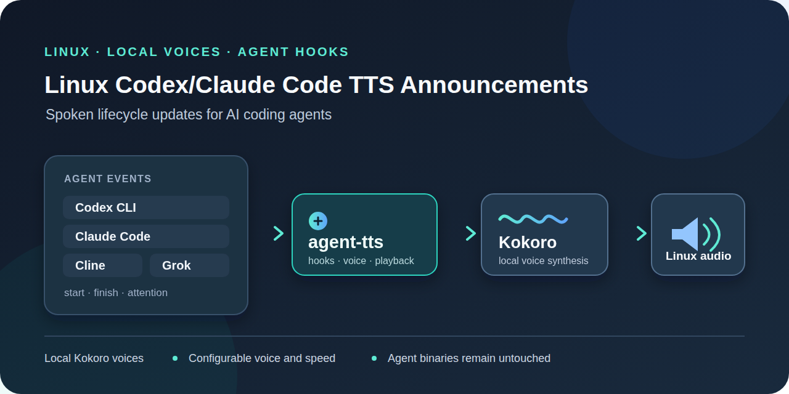

# Linux Codex/Claude Code TTS Announcements — Linux TTS Hooks for AI Coding Agents

[](https://github.com/mikaeltorni/linux_codex_claude_code_tts_announcements/commits/master) [](https://github.com/mikaeltorni/linux_codex_claude_code_tts_announcements/graphs/commit-activity) [](https://github.com/mikaeltorni/linux_codex_claude_code_tts_announcements/issues)

Linux Codex/Claude Code TTS Announcements is a Linux TTS hook engine that speaks lifecycle updates for developers using coding agents. Its standalone **`agent-tts`** engine and notify hooks support **Codex**, **Claude Code**, **Cline**, and **Grok**; Kokoro synthesis and audio playback run locally on Linux.



Part of [installation_scripts](https://github.com/mikaeltorni/installation_scripts). The Python speech engine is largely portable, but the audio playback backend is Linux-specific; Windows and macOS playback are untested.

**Contents:** [Quick start](#quick-start) · [Features](#linux-tts-features-for-coding-agents) · [Configuration](#configuration-linux-tts-voices-and-playback) · [Installation](#installing-linux-tts-hooks) · [Troubleshooting](#troubleshooting-linux-tts-playback) · [FAQ](#frequently-asked-questions-about-linux-tts-hooks) · [Contributing](#contributing) · [License](#license-and-disclaimer)

## Quick start

Install the isolated CPU Kokoro runtime and synchronize hooks for detected agents:

```bash
bash install.sh --prepare-speech
export PATH="$HOME/.local/bin:$PATH"
```

Use the standalone speech command to speak a line, announce an event, or ask for input:

```bash
agent-tts voice --text "The coding agent is ready." --voice af_sky
agent-tts announce --event finish --project-name "Demo project" --voice af_sky
agent-tts clarify --project-name "Demo project" --voice af_sky
```

The installer does not replace or symlink the `codex` or `claude` binaries. See [Linux speech prerequisites](#linux-speech-prerequisites) before running speech for the first time.

This repository ships two things:

1. **`agent-tts`** — the speech command. Its commands are `voice`, `say`,
   `announce`, `clarify`, `prewarm`, `speed`, `volume`, and `silent`. When
   `cargo` is on `PATH`, the installer builds the Rust binary. Kokoro synthesis,
   ffmpeg gain, and playback stay in `lib/agent_tts/engine.py`, and the binary
   calls that engine. Without `cargo`, the installer keeps the Python launcher.
2. **Notify hooks** — Codex, Claude Code, Cline, and Grok hooks that turn agent lifecycle
   events into spoken start/finish/attention/danger announcements.

## Linux TTS engine and hook dependencies

This repository has two layers with different dependencies:

- **The `agent-tts` engine is fully standalone.** It owns its tunables under the
  `ATTS_` ("agent TTS") environment namespace and a dedicated state directory,
  and has no dependency on Agent Command Center. The previous Agent Command
  Center names (`AGENT_COMMAND_CENTER_TTS_SPEED`, `..._VOLUME_PERCENT`,
  `ACC_SILENT`, `CODEX__TTS_VOICE`, `CLAUDE_TTS_VOICE`,
  `CODEX_AGENT_TRACKER_NO_AUDIO`) are still honored as fallbacks.
- **The notify hooks delegate orchestration to `codex-agent-tracker`** (Agent
  Command Center) for start/finish/attention announcements, so that the spoken
  finish label is summarized once and shared with the terminal title. Claude
  hooks forward the runtime session id so concurrent sessions in one project
  cannot reuse each other's title/finish labels. When the tracker executable
  is absent, speech operations use the same installed `agent-tts` CLI directly;
  titles and task summarization remain ACC-owned. Nothing here requires ACC
  to build, install, or speak lifecycle announcements.
- **Build-time (soft):** the shared installer component framework
  [`linux_installation_scripts_functions`](https://github.com/mikaeltorni/linux_installation_scripts_functions) —
  loaded from a sibling checkout when present. A standalone private checkout
  uses existing Git credentials to clone it non-interactively under the user
  cache; public deployments can still download it from a raw mirror. Override
  those sources with `ISC_FUNCTIONS_GIT_URL` or `ISC_FUNCTIONS_RAW`.

Agent Command Center delegates all speech to this repository's `agent-tts`
engine and installs it through its optional, opt-in `tts_announcements`
component: the master setup chain clones this repository first and Agent Command
Center then configures the engine, voice categories, and hooks as part of its
own install. Installing this repository on its own works too — its `install.sh`
sets up the engine and hooks independently.

See the full cross-repository map in
[installation_scripts/DEPENDENCIES.md](https://github.com/mikaeltorni/installation_scripts/blob/master/DEPENDENCIES.md).

## Linux TTS features for coding agents

Notify hooks preserve ACC’s selected `CODEX_AGENT_MODEL_NAME` for start and
finish announcements, with legacy Local/Qwen model variables as fallbacks.

Spoken model prefixes use **Luna**, **Terra**, **Sol**, and **Astra** without
GPT or version numbers, including announcements from already-running sessions.
Earlier models retain their full names, such as **GPT 5 point 5**.

Hook routing and hook-config writes are the `notify-agent` and `tts-hooks`
binaries. `notify-agent` reads a hook payload from stdin or one positional
JSON argument and always exits 0. Its commands are the payload itself and
`--grok` (which reads `GROK_EVENT` and `GROK_MESSAGE`). It asks
`codex-agent-tracker` to `announce`, `clarify`, `title`, `turn-start`, or
`turn-complete`. `tts-hooks` writes the config those hooks point at. Its
commands are `codex-hooks`, `claude`, `cline`, `grok`, `remove-codex`,
`remove-codex-hooks`, `remove-grok`, `remove-claude`, and `remove-cline`.
Kokoro synthesis, ffmpeg gain, and playback stay in `lib/agent_tts/engine.py`.

When installed, this repo:

- installs the `agent-tts` speech engine and links `~/.local/bin/agent-tts`
- installs `notify-agent` and `tts-hooks` next to that engine when cargo is available
- installs a hash-locked ONNX Runtime CUDA target when an NVIDIA GPU and `uv`
  are available; CPU synthesis remains the fallback
- copies hook code to `$HOME/.local/share/codex-claude-tts-announcements/`
- adds Codex `UserPromptSubmit` and `Stop` lifecycle hooks to the primary
  `$HOME/.codex` home and every existing `$HOME/.codex-account-N` home
- runs Codex `Stop` speech as a background hook and detaches again inside the
  notifier, so completion audio cannot hold up either new sessions or sessions
  that cached an older foreground hook definition
- removes the retired response-level Codex `notify = [...]` callback from each
  corresponding `config.toml`
- adds a Codex `PermissionRequest` attention hook to every managed Codex home
- adds generated Claude Code hook commands to `$HOME/.claude/settings.json`
- adds executable Cline lifecycle hooks under `$HOME/.cline/hooks/`
- removes the retired Agent Command Center `notify_agent.py` hook entries

It does not replace or symlink the `codex` or `claude` binaries.

## Using the standalone `agent-tts` CLI

```bash
agent-tts voice --text "hello" --voice af_sky   # speak a literal line
agent-tts announce --event start --project-name "Demo project" --voice af_sky
agent-tts announce --event finish --project-name "Demo project" --voice af_sky
agent-tts clarify --project-name "Demo project" --voice af_sky
agent-tts speed 1.5                              # read/set the speed multiplier
agent-tts volume 1000                            # read/set the volume percentage
agent-tts silent toggle                          # mute/unmute all announcements
```

Detached agents can finish simultaneously. Cache generation is locked per
utterance and published atomically, so identical requests share one complete
WAV instead of racing over a partial file. Playback (including the desktop
fallback synthesizers) is serialized across processes so announcements do not
overlap or break the PipeWire/PulseAudio connection. Identical requests that
arrive within one 30-second burst are coalesced at that shared playback boundary,
so competing detached hooks cannot turn the lock into a queue that repeats the
same clip; a later turn can still repeat the wording normally. Direct `voice`,
`announce`, and `clarify` commands return nonzero when neither Kokoro nor a
fallback can handle the message. Kokoro calls time out instead of holding a
cache lock forever, and later runs remove abandoned temporary work directories
after their safe age threshold.

## Configuration: Linux TTS voices and playback

Tunables (environment overrides win over persisted values):

- `ATTS_SPEED` — speech speed multiplier (default `1.5`).
- `ATTS_VOLUME_PERCENT` — linear volume percentage (default `1000`).
- `ATTS_SILENT` — set truthy to mute one invocation.
- `ATTS_SUPPRESS_ANNOUNCEMENTS` — set truthy in a CLI's environment to make
  every notification hook and direct `agent-tts announce`/`clarify` call of
  that process exit silently. Used by monitoring surfaces and informational
  CLI probes that are not human-driven agent sessions, whose lifecycle hooks
  would otherwise announce fake starts and finishes.
- `ATTS_VOICE` — global voice override.
- `ATTS_CODEX_VOICE`, `ATTS_CLAUDE_VOICE`, `ATTS_CLINE_VOICE`,
  `ATTS_GROK_VOICE`, `ATTS_QWEN_VOICE`, `ATTS_OPENROUTER_VOICE`, and
  `ATTS_NVIDIA_VOICE` —
  per-runtime overrides when `ATTS_VOICE` is unset. Legacy
  `CODEX_TTS_VOICE`, `CLAUDE_TTS_VOICE`, `GROK_TTS_VOICE`, and
  `QWEN_CODEX_TTS_VOICE`, plus `OPENROUTER_CODEX_TTS_VOICE` and
  `NVIDIA_CODEX_TTS_VOICE`, remain supported. ACC wrappers' normalized
  `CODEX__TTS_VOICE` remains a fallback for Codex, Claude, Qwen, and Cline.
- Default Kokoro voices per runtime (when no override is set): codex `af_bella`,
  claude `af_sky`, qwen/Local `af_heart`, cline `af_aoede`, grok `af_kore`,
  OpenRouter `af_jessica`, and NVIDIA `af_sarah` (all distinct). Grok,
  OpenRouter, and NVIDIA ignore a generic shell-wide `CODEX__TTS_VOICE` so a
  stale Local/Qwen export cannot override their reserved per-runtime voices.
- `ATTS_MODEL_DIR` — optional shared Kokoro model directory. Cline and Claude
  automatically reuse `~/.codex/tts` when their own config homes have no model
  assets, avoiding duplicate downloads and robotic fallback speech.
- `ATTS_DEVICE` — `auto` (default), `cuda`/`gpu`, or `cpu`. Auto mode uses the
  installed CUDA runtime only when at least 1024 MiB of VRAM is free. A CUDA
  synthesis error is logged and retried once on CPU.
- `ATTS_GPU_MIN_FREE_MIB` — change the auto-mode free-VRAM guard (default
  `1024`). `ATTS_GPU_RUNTIME_DIR` overrides the installer-managed runtime path.
  Note: because every announcement is a fresh `uvx`/ONNX subprocess, a
  one-sentence clip is dominated by cold process and model-load startup (~6 s),
  not inference — CUDA does not make short announcements meaningfully faster. GPU
  mainly helps longer text; the boot prewarm below is what removes the first-run
  stall.

### Boot prewarm (`boot_prewarm` component)

The `boot_prewarm` component installs a `systemd --user` oneshot,
`agent-tts-prewarm.service` (`WantedBy=default.target`), that runs one silent
`agent-tts prewarm` at login. This warms the `uvx` environment, the ONNX model,
and the OS page cache before the first agent turn speaks, so the first
announcement no longer pays the cold ~6 s startup on the critical path.
Warming is best-effort (`Nice=10`, no audio, always exits 0) and never stalls
the session. Run `agent-tts prewarm` by hand to warm the current shell.

### Lifecycle announcement settings

- `ATTS_ANNOUNCE_WORKSPACE=0` — disable the spoken workspace suffix. On X11,
  tmux announcements resolve the terminal attached to the announcing pane's
  session, using the client's window identity rather than the pane's inherited
  `WINDOWID`. Workspace numbers are one-based and placement is read for each
  announcement, so moving a terminal changes its subsequent announcements.
  Detached sessions, missing terminal windows, sticky windows, and attached
  terminals on different workspaces say "on an unknown workspace"; they do not
  borrow the focused window's workspace. Direct callers outside tmux use their
  own `WINDOWID`; desktop focus is a fallback only without a terminal identity.
  Without a terminal identity, if every `xprop` workspace probe fails (e.g.
  GNOME on Wayland without usable EWMH properties), probing backs off
  for 5 minutes after a fully-failed attempt instead of re-running failing
  probes — and logging their failures — on every announcement.
- `ATTS_ANNOUNCE_START`, `ATTS_ANNOUNCE_FINISH`, and
  `ATTS_ANNOUNCE_ATTENTION` — override the independently installed lifecycle
  categories. Their persisted values live in
  `~/.config/agent-tts/announcements.env`.
- `ATTS_EVENT_CONFIG_FILE` — override that persisted event-settings path.
- `ATTS_NO_AUDIO` — when truthy, generate/cache clips but never play (used by
  tests); an explicit false value such as `0` leaves playback enabled.
- `ATTS_STATE_DIR` — override the engine state/cache directory.
- `ATTS_LOG_DIR` — override where `agent-tts` writes `voice.log`.

## TTS logging and diagnostics

Python diagnostics are routed through `lib/tts_announcements/logging_utils.py`.
By default, source-checkout logs are written under this repository's `.log/`
directory, while installed integrations can override the sink with
`ATTS_LOG_DIR` or `AGENT_COMMAND_CENTER_LOG_DIR`. The Bash installer mirrors its
status messages to `install.log` under `TTS_LOG_DIR` or the repository `.log/`
directory without changing its stdout output.

Free text forwarded to `codex-agent-tracker` on its command line (prompts,
task descriptions, attention questions) is whitespace-normalized and clipped
to 600 characters before exec: these strings only feed spoken announcements
and terminal titles, and unbounded text previously aborted the launch with
`[Errno 7] Argument list too long`, silently dropping the announcement.

## Linux speech prerequisites

- `ffmpeg` and `libportaudio2` for the installed speech runtime. On Ubuntu,
  install these separately with `sudo apt-get install -y ffmpeg libportaudio2`.
  The normal terminal installer and `--prepare-speech` install an isolated CPU
  Kokoro runtime plus verified model/voice assets under
  `~/.local/share/codex-claude-tts-announcements/`; ACC is not required.
  Existing `<codex-home>/tts` assets and the legacy `uvx` path remain supported.
- Optional GPU synthesis needs an NVIDIA GPU and `uv`. The installer places the
  CUDA 12/cuDNN runtime under
  `~/.local/share/codex-claude-tts-announcements/gpu-runtime`; set
  `ATTS_INSTALL_GPU_RUNTIME=0` while installing to keep a CPU-only setup.
- With ACC installed, notify hooks keep its tracker/title/task-summary behavior.
  Without its tracker executable, speech calls the installed `agent-tts` directly.
  An installed tracker returning an error never causes duplicate fallback speech.

## Installing Linux TTS hooks

```bash
bash install.sh              # terminal: offer missing Codex/Claude, then choose voices
bash install.sh --install-harnesses codex,claude # install both native CLIs and configure TTS
bash install.sh --install-harnesses codex  # install Codex only, then sync detected hooks
bash install.sh --install-harnesses claude # install Claude only, then sync detected hooks
bash install.sh --install-harnesses missing # install only missing native CLIs, then sync
bash install.sh --install-harnesses none # skip CLI installation, sync detected hooks
bash install.sh --sync-harnesses  # detected harnesses, saved voices, no prompts
bash install.sh --prepare-speech # install speech runtime/models, then sync hooks
bash install.sh --disable-harnesses # remove managed hooks; retain voice choices
tts-reconcile                # refresh enabled hooks without building/downloading
bash install.sh --default    # legacy component defaults, no prompts
bash install.sh --all        # install every component
bash install.sh --list-components
bash install.sh --select engine,claude_stop   # install exactly these
```

On a terminal, `bash install.sh` first offers **skip** or **install** for each
missing Codex/Claude executable. Configuration directories alone do not count
as an installed native CLI. Skip is preselected; choose with the arrow keys and
Enter, or press `q` to cancel before installing either provider. Both choices
are collected before delegation. Cancelling the later voice selection leaves
already-installed native CLIs in place and preserves voice choices and hooks.
Set `TTS_INSTALL_HARNESSES=none` to omit these installation questions, or use
`missing`, `codex`, `claude`, or `codex,claude` to select them before interactive
voice selection; the default is `ask`.

Native CLI installation belongs to
[`linux_codex_claude_code_setup`](https://github.com/mikaeltorni/linux_codex_claude_code_setup).
This installer delegates its barebones `codex_cli` / `claude_code` components,
then verifies each selected command with `--version` before configuring TTS.
It reuses a sibling or `~/projects/linux_codex_claude_code_setup` checkout,
or clones that repository when absent. Private repositories require configured
Git credentials or a transferred checkout; the provider repository was private
during the October 2026 VM verification, so anonymous cloning was unavailable.
`TTS_CLI_SETUP_DIR=/path/to/checkout` explicitly selects an existing checkout;
`TTS_CLI_SETUP_REPOSITORY` overrides the clone URL. No credentials are copied
or requested by the TTS installer.

For a fresh Ubuntu machine, install the optional provider bootstrap prerequisites
separately, then run the TTS installer as your normal desktop user:

```bash
sudo apt-get install -y git ca-certificates curl build-essential nodejs npm ffmpeg libportaudio2
bash install.sh --install-harnesses codex,claude
export PATH="$HOME/.local/bin:$PATH"
hash -r
codex --version
claude --version
```

The owner bootstraps a user-local Rust toolchain when needed and persists
`~/.local/bin` in future Bash/login shells. The default `TTS_CODEX_SOURCE=npm`
uses the official Codex npm package; `TTS_CODEX_SOURCE=fork` delegates the
owner's local-fork build path and requires its additional build dependencies
and fork access. CLI sign-in remains a separate user action. These steps install
CLIs, speech runtime, verified models and hooks. System packages listed above
are reported separately when absent; the user-level installer never runs sudo.

The standalone terminal, `--install-harnesses`, `--prepare-speech`, `--sync-harnesses`, and
`--disable-harnesses` paths do not need the shared component framework when run
as a normal user. Legacy component commands and sudo-chain targeting still use
that framework. `--install-harnesses=VALUE` also accepts the selectors above;
`ask` is accepted with a real terminal. Unattended calls should use explicit
providers, `missing`, or `none`. Delegated failures propagate before TTS hooks
are enabled; provider installation itself may already have made changes.

`--prepare-speech` is the complete unattended speech setup used by ACC. It
reuses saved voices and event settings, installs hash-pinned CPU dependencies,
and downloads SHA-256-verified Kokoro v1.0 model/voice files. When uv is absent,
it bootstraps the pinned verified uv release into the speech owner's directory.
`--sync-harnesses` refreshes the engine and hooks without preparing CPU synthesis
dependencies or models; `tts-reconcile` remains free of builds and downloads.
Set `TTS_INSTALL_SPEECH_RUNTIME=0` only to explicitly skip runtime provisioning
(for example, an offline deployment with synthesis already installed).

CPU dependencies are pinned with hashes in `requirements-speech.txt`, generated
from `requirements-speech.in` under the rolling 24-hour publication delay:

```bash
uv pip compile --generate-hashes --exclude-newer '24 hours' --python-version 3.12 \
  requirements-speech.in -o requirements-speech.txt
```

The fresh Ubuntu VM regression replays the reported greeting's start/finish
hooks and captures non-silent audio from the actual output sink. CLI version
checks and installed hooks alone do not establish that speech works.

Voice selection detects supported command names on `PATH`
and existing configuration homes: Codex (including `.codex-account-N`), Claude
Code, Qwen/Local, Cline, Grok, OpenRouter, NVIDIA and OpenCode. Use the up/down
arrows to choose a voice and Enter to confirm each harness family; `q` or Ctrl+C
cancels before changing voice choices or harness hooks. OpenCode speech is
tracker-driven; this installer does not add unsupported native OpenCode hooks.
Without a terminal, the no-argument invocation retains the installation-config
component flow; use `--sync-harnesses` for unattended harness discovery.

Edit the `TTS_VOICES=(...)` Bash array near the top of `install.sh` to change the
offered voice ids. It includes the existing voices `af_bella`, `af_sky`,
`af_heart`, `af_aoede`, `af_kore`, `af_jessica` and `af_sarah`. Reordering or
extending this list does not change runtime defaults. Saved choices are kept in
`~/.config/agent-tts/voices.json`, preselected on later manual runs, and still
offered if removed from the catalog. Codex accounts share their family's voice.
The per-runtime defaults listed above remain unchanged.

Manual selection and `--sync-harnesses` enable automatic hook management via
`~/.config/agent-tts/harness-hooks.enabled`. The installed `tts-reconcile`
command reuses saved choices without prompting, compiling or downloading. It
leaves existing event-category settings intact and does nothing after integration
is disabled. Explicit `ATTS_VOICE` and per-runtime `ATTS_*_VOICE` overrides take
precedence over saved ACC voice choices. Existing ACC fallbacks remain in use
when no choice is saved. Run `tts-reconcile --help` for its usage.

GPU Python dependencies are pinned in `uv.lock` and exported with hashes in
`requirements-gpu.txt`. The project-level `exclude-newer = "24 hours"` policy
prevents newly published dependency releases from entering a regenerated lock;
plain `pip install <package>` is not a supported installation path.

### Selectable coding-agent hook components

Every individual notify hook is its own optional, default-on component, so you
can wire up exactly the runtimes and lifecycle events you use. The `engine` and
`hook_files` core stay default-on, and **each hook component also self-installs
that core**, so the program works no matter which subset you pick.

| Component | What it installs |
|---|---|
| `codex_cli` | optional, default-off native Codex CLI through the setup owner |
| `claude_cli` | optional, default-off native Claude Code CLI through the setup owner |
| `engine` | `agent-tts` speech engine + `~/.local/bin/agent-tts` symlink |
| `speech_runtime` | default-on isolated CPU Kokoro dependencies and verified voice/model files |
| `hook_files` | notify hook code under `~/.local/share/codex-claude-tts-announcements/` |
| `boot_prewarm` | login-time `agent-tts-prewarm.service` user unit |
| `start_voice` | enable start announcements for every runtime |
| `finish_voice` | enable end announcements for every runtime |
| `attention_voice` | enable ask-for-further-changes / needs-input announcements |
| `codex_notify` | Codex `UserPromptSubmit` start and `Stop` finish hooks in primary and numbered account homes (detached from slow synthesis/title work, with legacy `notify` migration) |
| `codex_attention` | Codex `PermissionRequest` attention hook in primary and numbered account homes |
| `grok_notify` | Grok `[[ui.notifications.hooks]]` lifecycle block in `~/.grok/config.toml` (start/finish/attention via `$GROK_EVENT`) |
| `claude_session_start` | Claude Code `SessionStart` hook |
| `claude_stop` | Claude Code `Stop` hook |
| `claude_subagent_stop` | Claude Code `SubagentStop` hook |
| `claude_user_prompt` | Claude Code `UserPromptSubmit` hook |
| `claude_notification` | Claude Code `Notification` hook |
| `cline_task_start` | Cline `TaskStart` hook |
| `cline_task_resume` | Cline `TaskResume` hook |
| `cline_task_complete` | Cline `TaskComplete` hook |
| `cline_task_cancel` | Cline `TaskCancel` hook |
| `cline_task_error` | Cline `TaskError` hook (supported by current CLI releases) |
| `cline_user_prompt` | Cline `UserPromptSubmit` hook |
| `cline_pre_tool_use` | Cline `PreToolUse` hook — speaks an attention prompt when Cline calls `ask_question` |

The Claude and Codex hook writers are idempotent and preserve unrelated
user-authored hooks; reruns also remove the retired Agent Command Center
`notify_agent.py` hook entries. None of these replace or symlink the `codex` or
`claude` binaries.

## Agent Command Center integration

The master setup chain clones this repository before Agent Command Center.
ACC exposes `tts_announcements` as an optional installer component (off until
selected). Its configuration action opens this repository's voice picker;
normal installation delegates to `--sync-harnesses` without a nested menu.
The legacy `AGENT_COMMAND_CENTER_INSTALL_TTS_ANNOUNCEMENTS=1` install-time
opt-in uses the same path.

```bash
bash ~/projects/agent_command_center/install.sh --select tts_announcements
bash ~/projects/agent_command_center/install.sh --configure-component tts_announcements
```

When enabled, ACC runs the installed reconciler after every new Codex account
is created and when installed harnesses are refreshed, including the login-time
refresh. New accounts receive the lifecycle and attention hooks with the saved
Codex voice. Opting out through ACC or `bash install.sh --disable-harnesses`
removes managed hooks across the detected harness families and prevents later
account creation from restoring them. Saved voice choices and unrelated hooks
are retained. The speech engine remains available for direct use.

## Reconfiguring and uninstalling Linux TTS hooks

This installer tracks what it has installed and can re-apply or remove it, so you
can refresh configuration after a repo update or cleanly back a feature out.

```bash
bash install.sh --detect            # show each component as installed|absent
bash install.sh --reconfigure a,b   # re-apply (idempotent) these component ids
bash install.sh --uninstall a,b     # uninstall these component ids
```

In the shared component menu (when exposed through a parent installer),
already-installed components show a green `✓`. Select one with
**space** to **reconfigure** it (`~`), press **`u`** to mark it for **uninstall**
(`✗`), or press **`r`** to reconfigure every installed component at once. Detection
uses a live check where deterministic and otherwise an install receipt under
`${XDG_STATE_HOME:-~/.local/state}/isc/receipts/`; a component without a reversal
step simply clears that receipt on uninstall.

## Frequently asked questions about Linux TTS hooks

### Can I use the TTS engine without Agent Command Center?

Yes. The `agent-tts` engine installs and speaks independently; when the optional
tracker executable is present, hooks use it for shared titles and task summaries.

### Which coding agents get native notification hooks?

The installer provides native lifecycle hooks for Codex, Claude Code, Cline,
and Grok. OpenCode speech is tracker-driven, and this installer does not add
native OpenCode hooks.

### Does `--prepare-speech` install the Kokoro runtime?

Yes. `bash install.sh --prepare-speech` provisions the isolated CPU runtime and
verified Kokoro model and voice files before synchronizing detected hooks;
`--sync-harnesses` refreshes hooks without preparing those assets.

### Does the TTS installer replace or install the coding-agent binaries?

It never replaces or symlinks the `codex` or `claude` binaries. Optional native
CLI installation is delegated to `linux_codex_claude_code_setup`; the
`--prepare-speech` path does not install those CLIs.

### Are Windows and macOS audio playback supported?

No compatibility claim is made for Windows or macOS playback. The Python engine
is largely portable, but the playback backend is Linux-specific and those
platforms are untested.

### Why can playback logs succeed while no sound is audible?

PipeWire and PulseAudio keep a separate Agent TTS stream volume. Check that
stream and the selected output device in your audio mixer; a successful player
exit confirms submission to the audio server, not speaker output.

## Contributing

This repository is maintained as a private project. Coordinate proposed changes
with the owner, keep changes focused, and preserve the standalone engine,
idempotent hook setup, and unrelated user-authored configuration.

## License and disclaimer

This project is licensed under the [MIT License](LICENSE.md).

This software is provided under the MIT License on an **“as is”** basis, without warranties of any kind. To the maximum extent permitted by applicable law, the authors and copyright holders shall not be liable for any claims, damages, losses, or other liability arising from the use of this software.

You are solely responsible for determining whether this software is suitable, safe, lawful, and appropriate for your intended use. Unless explicitly stated otherwise, this project is general-purpose software and is not designed, tested, certified, or approved for safety-critical, medical, automotive, aviation, industrial-control, life-support, cybersecurity-critical, financial-critical, or other high-risk use cases.

The authors and copyright holders make no guarantees regarding security, reliability, availability, correctness, compliance, non-infringement, or fitness for any particular purpose.

This notice is intended to clarify the nature of the project and does not impose additional restrictions beyond the MIT License.

## Troubleshooting Linux TTS playback

### Why does speech play silently even when playback logs succeed?

PipeWire and PulseAudio playback use the **Agent TTS** application identity and
Notification role. This gives speech its own saved stream volume instead of
inheriting `pw-play`'s Music volume (which can be zero while the output device
is unmuted). Check the Agent TTS stream and selected output in your audio mixer
if speech is still inaudible; a successful player exit confirms submission to
the audio server, not audible output from the speakers. Reinstall the `engine`
component after updating playback code: `bash install.sh --select engine`.

## Lifecycle hook behavior notes

Child `SubagentStop` hooks are intentionally silent: they inherit their parent's
tracker token but do not mean the parent task is done. This also applies to
Grok goal planners using Claude-compatible hooks. The parent's `Stop` still
triggers its normal completion announcement.

Typed Claude/Grok `Notification` events request spoken attention only for
`permission_prompt`. Background `task_complete`, idle, and informational events
stay silent. Both `notification_type` and Grok's `notificationType` are supported;
legacy untyped messages retain their existing handling.
